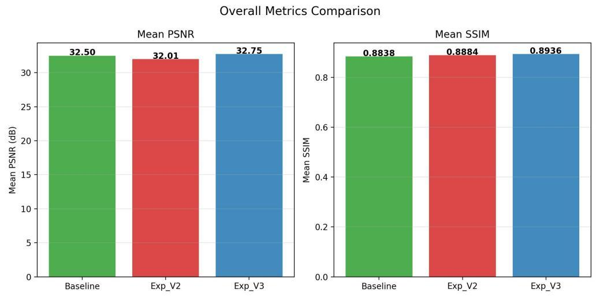
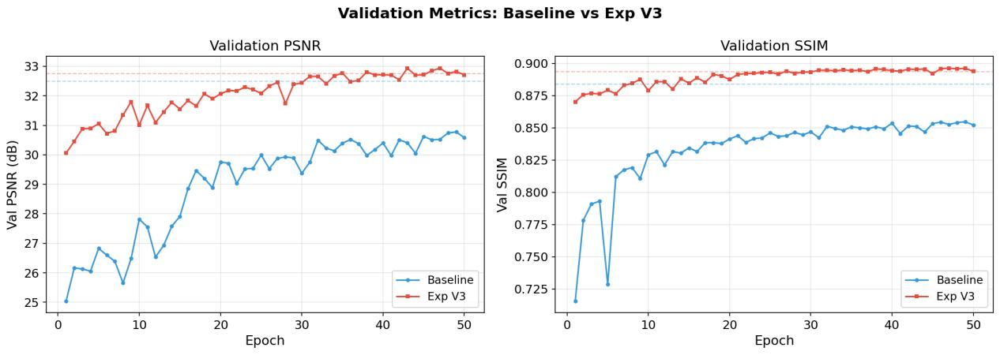
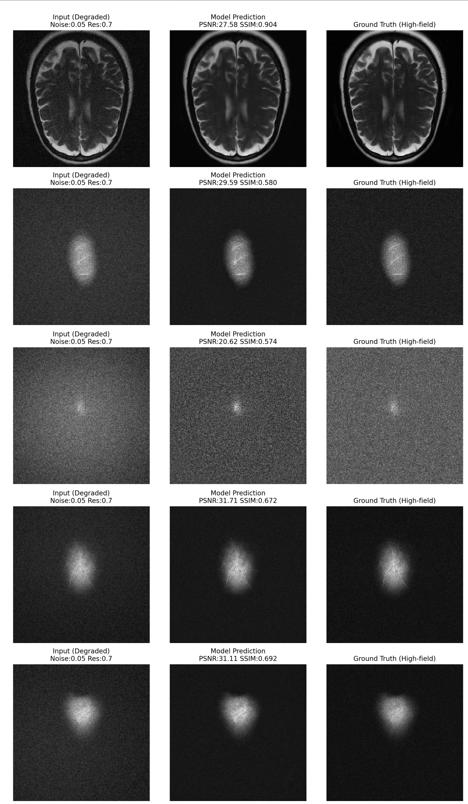

# Low-Field MRI Reconstruction with fastMRI U-Net

A reproducible pipeline for **simulated low-field MRI enhancement** on fastMRI brain data. High-field images are degraded with k-space truncation, a smooth bias field, and Rician noise; a U-Net then reconstructs the high-field image. The repository compares a pixel-loss baseline, SSIM + residual learning, and a combined SSIM + k-space L1 + cosine-restart variant.

## Results

| Model | Key changes | PSNR (dB) | SSIM |
| --- | --- | ---: | ---: |
| Baseline | U-Net + 0.2 MSE + 0.8 L1 + StepLR | 32.50 | 0.8838 |
| Exp V2 | + SSIM loss + k-space L1 + CosineAnnealingWarmRestarts + residual | 32.01 | 0.8884 |
| **Exp V3 (best)** | + SSIM loss + residual learning + StepLR | **32.75** | **0.8936** |

- Exp V3 vs baseline: **+0.25 dB PSNR**, **+0.0098 SSIM** on 93 test slices.
- **92.5%** of test slices improve SSIM; the worst-case slice improves SSIM by **23.8%**.
- Best validation PSNR improves from **30.78 dB** to **32.94 dB**.
- Adding k-space L1 and cosine restart (Exp V2) reduces PSNR to 32.01 dB; the final model keeps only SSIM loss and residual learning.







## Low-field simulation

`dataset.py` simulates low-field degradation on the fly:

1. Keep the central **70%** of k-space and transform back to the image domain.
2. Apply a smooth random Gaussian bias field.
3. Add Rician noise with **sigma = 0.05**.

All three parameters are configurable from the training and evaluation CLIs.

## Training setup

- Optimizer: Adam, learning rate `1e-4`
- Batch size: `4`
- Epochs: `50`
- Early stopping: validation PSNR, patience `10`
- Baseline loss: `0.2 * MSE + 0.8 * L1`
- Exp V3 loss: pixel loss + `1.0 * (1 - SSIM)`
- Seed: `0`, deterministic cuDNN

## Repository layout

```text
.
├── dataset.py                    # NPZ dataset + low-field degradation simulation
├── prepare_dataset.py            # fastMRI H5 -> 320x320 NPZ slices
├── create_splits.py              # train/val/test split
├── train.py                      # baseline U-Net training
├── experiments/
│   ├── exp_v2/train_v2.py        # SSIM + k-space L1 + cosine restart + residual
│   └── exp_v3/train_v3.py        # SSIM + residual + StepLR (best)
├── test.py                       # per-slice PSNR/SSIM + visualizations
├── inference.py                  # single-sample visualization
├── analyze_worst_samples.py      # worst-case residual analysis
├── generate_report.py            # metrics report + plots
├── plot_metrics.py               # compare multiple experiment folders
├── docs/figures/                 # result figures used in this README
├── results/summary.csv           # summary of the three experiments
└── data/                         # local data (not committed)
```

## Setup

```bash
python -m venv .venv
# Windows
.venv\Scripts\activate
# Linux / macOS
source .venv/bin/activate

pip install -r requirements.txt
```

## Data

The fastMRI dataset is **not included** because it requires registration and acceptance of its data use agreement. Download the brain subset from the official fastMRI distribution, then place the `.h5` files under `data/raw/`.

Expected H5 fields:

- `kspace`: multi-coil k-space, shape `(slices, coils, height, width)`
- `reconstruction_rss`: high-field reference, shape `(slices, height, width)`

Convert and split:

```bash
python prepare_dataset.py --input-dir data/raw --output-dir data/npz
python create_splits.py --src data/npz --out data/splits
```

`prepare_dataset.py` writes `input` and `target` in each NPZ. The training dataset uses `target` and re-simulates low-field degradation with controllable `--noise`, `--res-ratio`, and `--no-bias` flags; `input` is kept for inspection.

## Training

Baseline:

```bash
python train.py \
  --data-path data/splits/train \
  --val-path data/splits/val \
  --save-dir checkpoints/baseline
```

Exp V2:

```bash
python experiments/exp_v2/train_v2.py \
  --data-path data/splits/train \
  --val-path data/splits/val \
  --save-dir checkpoints/exp_v2
```

Exp V3 (best):

```bash
python experiments/exp_v3/train_v3.py \
  --data-path data/splits/train \
  --val-path data/splits/val \
  --save-dir checkpoints/exp_v3
```

All scripts use seed 0 and deterministic cuDNN settings by default.

## Evaluation

```bash
python test.py \
  --data-path data/splits/test \
  --ckpt checkpoints/exp_v3/best_unet_lowfield.pth \
  --residual --all \
  --output-dir test_results/exp_v3

python generate_report.py \
  --metrics test_results/exp_v3/metrics.csv \
  --outdir test_results/exp_v3/report
```

Single-sample visualization:

```bash
python inference.py \
  --data-path data/splits/test \
  --ckpt checkpoints/exp_v3/best_unet_lowfield.pth \
  --residual \
  --output test_results/inference.png
```

Worst-case analysis:

```bash
python analyze_worst_samples.py \
  --metrics test_results/exp_v3/metrics.csv \
  --data-root data/splits/test \
  --ckpt checkpoints/exp_v3/best_unet_lowfield.pth \
  --test-images-dir test_results/exp_v3 \
  --outdir test_results/worst_analysis
```

## Notes and limitations

- Low-field degradation is **simulated** with k-space truncation, bias field, and Rician noise; this is not real low-field clinical data.
- The test set contains 93 slices from a single random split, so the reported differences are small and should not be over-interpreted.
- The k-space L1 + cosine-restart variant was not beneficial in this setting; the ablation is included because negative results are useful for reproducibility.
- fastMRI data and model checkpoints are not committed.

## Acknowledgements

This project uses the [fastMRI](https://fastmri.org/) dataset and the U-Net implementation from the fastMRI codebase. Please follow the fastMRI data use agreement when using the dataset.

## 中文简介

本项目在 fastMRI brain 数据上模拟低场 MRI 退化（K 空间 70% 截断、偏置场、Rician 噪声），比较 U-Net 基线、SSIM Loss、残差学习和频域损失的组合。最优模型 V3 在 93 例测试切片上达到 PSNR 32.75 dB、SSIM 0.8936；SSIM Loss + 残差学习是主要增益来源，频域损失 + 余弦退火在该任务上没有正向贡献。
